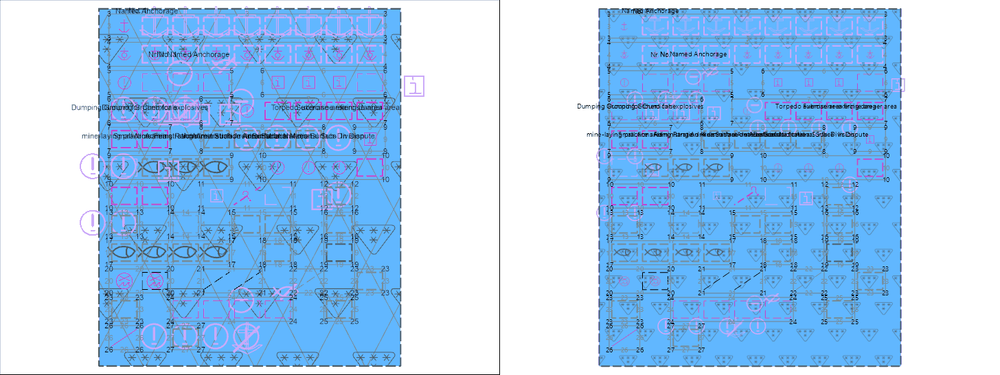
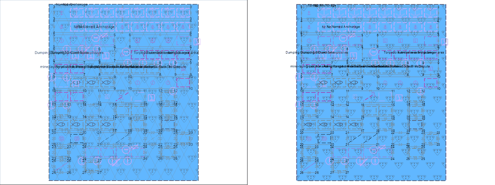
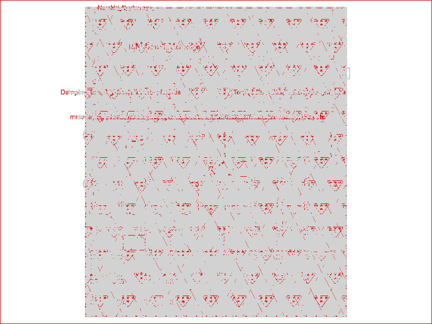
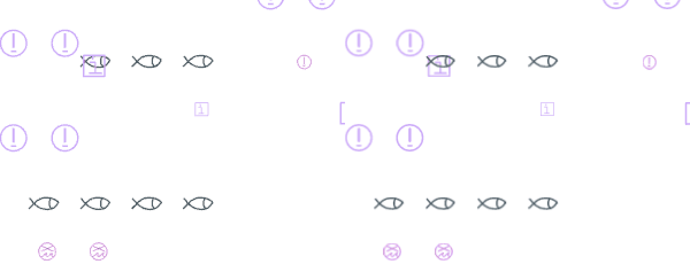
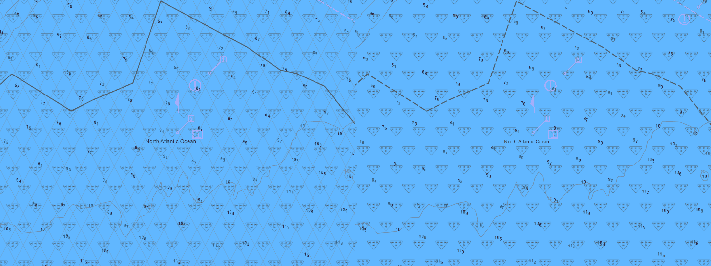
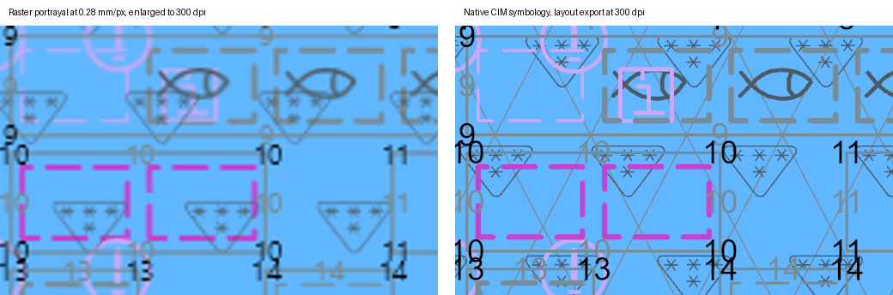

# Native Pro symbology from S-100 portrayal: spike

This note records the A14 spike (issue
[#16](https://github.com/philliphoff/EncDotNet.ArcGIS/issues/16), epic
[#1](https://github.com/philliphoff/EncDotNet.ArcGIS/issues/1)): how far
EncDotNet.S100's S-100 portrayal can be expressed as ArcGIS Pro symbology
(CIM) on feature data, so a SoundCharts chart can be a real Pro layer and
print as vectors. It covers the approach, the measurements, the gaps, a
recommendation and a slice plan. The prototype is
[`tools/SymbologySpike`](https://github.com/philliphoff/EncDotNet.ArcGIS/tree/main/tools/SymbologySpike), outside the add-in.

**Recommendation: partial go.** Native symbology reproduces the portrayal
closely and prints as vectors, but has known gaps and depends on a data path
that isn't settled. Build it as an export and analysis path beside the
raster chart layer, not as a replacement for it. See
[Recommendation](#recommendation).

## Problem

Charts display as WMTS tiles from `s100 tiles serve` (design brief D10), so
a printed layout carries pixels. A10 renders those pixels at the layout's DPI,
but they're still pixels, and a chart layer isn't something Pro can select,
label or restyle. A13 made the features into Pro feature classes with Pro's
default symbols. The question: can the S-100 portrayal itself, the symbols,
line styles, fills and text an ECDIS draws, become CIM on those features?

## Approach

S-100 portrayal (Part 9) runs Lua rules per feature and emits drawing
instructions: a point symbol, a line style, an area fill or a colour, text,
each with a drawing priority, viewing group, display plane and SCAMIN.
Instead of translating the Lua rules into CIM (a second portrayal engine),
the prototype runs EncDotNet.S100's own portrayal in process and stores the
output:

1. `IVectorPortrayalSource.BuildVectorPortrayalAsync` (EncDotNet.S100 0.27.0)
   gives the instructions, the palette, the feature geometry and the
   catalogue's symbols, line styles and area fills.
2. Each instruction becomes **one row**, with the feature's geometry and
   the fields `SymKey` (which symbol), `Priority`, `ViewingGroup`, `Plane`,
   `Scamin`, `FeatureRef` (the A13 join key), `Rotation`, and `Txt` for
   text. Rows go to five layers by geometry and kind: **AreaFills**
   (polygons), **AreaSymbols** (point symbols on areas, as polygons),
   **Lines**, **Points**, **Text**.
3. Each distinct `SymKey` becomes a CIM symbol, and each layer a
   `.lyrx` with a unique value renderer on `SymKey`. Points rotate by a
   rotation visual variable on `Rotation`.
4. `render_layout.py` (arcpy) loads the rows into a file geodatabase, adds
   the layer files to a Web Mercator map and exports layouts, then renders
   the same extent with `s100 render` and compares the images.

| S-100 construct | CIM used |
|---|---|
| SVG point symbol (`path` M/L/Z, `circle`, `rect`, colour classes) | `CIMVectorMarker` with the symbol's own geometry; colours resolved from the palette |
| Line style: pen, dashes, symbols every interval | `CIMSolidStroke` + `CIMGeometricEffectDashes`; `CIMVectorMarker` with `CIMMarkerPlacementAlongLineSameSize` |
| Composite line style | One `CIMLineSymbol` with the components' layers |
| Colour fill with transparency | `CIMSolidFill` with alpha |
| Pattern fill (symbol on a lattice) | `CIMVectorMarker` with `CIMMarkerPlacementInsidePolygon` (fixed grid, `shiftOddRows`) |
| Point symbol on an area | `CIMMarkerPlacementPolygonCenter` on the polygon |
| Text instruction | A `CIMVectorMarker` holding a text graphic, its string from `Txt` through a `CIMPrimitiveOverride` (`TextString`) |
| Drawing priority | Renderer class order (one class per symbol and priority) and the layer stack |
| Display category, viewing groups | Definition query on `ViewingGroup` |
| SCAMIN | Scale-based display filters (`CIMDisplayFilter`) |
| Palette | Colours baked into the CIM; a palette change rewrites the renderer only |

### Plugin datasource

The spike was meant to symbolize A13's plugin datasource layers. On this
machine Pro 3.7.3 still doesn't find the installed plugin (A13's open
question). The time-boxed look found that Pro's native add-in manager
(`DADFLib.dll`, which loads `CLR:PluginDS` factories) keeps its own add-in
folder list (`AddInFolders`, `AddInFoldersList.xml`), separate from the
managed loader that finds the add-in; the plugin's folder may not be on it.
That wasn't fixed, so **the prototype uses a file geodatabase** made from the
same portrayal, as #16 allows. Symbology doesn't depend on the source: the
renderer reads fields, and a plugin table with the same fields would draw
the same.

## Measurements

Cells: EncDotNet.S100's S-101 test cell `101AA00DS0016` (572 instructions;
`101AA0000DS0009`, the visual regression fixture, has only 8), and
`US5MA1BO` (S-57, 1,996 instructions, the only test cell with SCAMIN).
Pinned `s100` 0.27.1-main.20261113, Pro 3.7.3, Day palette, all viewing
groups. The comparison image is 728 × 546 px at 91 dpi (0.28 mm per pixel,
the pixel `s100 render` assumes) in Web Mercator; a pixel differs when a
channel differs by more than 48 from every pixel within one pixel of it in
the other image.

### Conversion

| | Result |
|---|---|
| S-101 catalogue SVG symbols converted to vector geometry | 718 of 718 (2,888 elements, none skipped) |
| S-101 line styles mappable | 59 of 59 (dashes and symbols; 2 composite; no symbol rotation used) |
| S-101 area fills mappable exactly | 10 of 25; 15 have oblique lattices that a CIM grid only approximates |
| Classes per cell | 44 (`101AA00DS0016`), 55 (`US5MA1BO`) |
| Portrayal in process, first / after a safety contour change | 0.33–0.40 s / 0.15–0.23 s (`101AA00DS0016`); 0.30 s / 0.15 s (`US5MA1BO`) |
| Instructions to rows and CIM | 40–45 ms |
| Layout export, PNG 91 and 300 dpi, PDF | 0.6–1.2 s each |
| PDF of the native layout | 156–163 KB, no raster images (all vector) |

### Size convention

The first comparison differed on 6.9% of pixels: native point symbols were
about 1.6 times the raster's, and pattern tiles 2.4 times. EncDotNet.S100's headless renderer doesn't
draw Part 9 millimetres at size: lines and offsets at 1 px per 0.32 mm,
point symbols at 0.6 of 96 dpi, line-style symbols at 1 px per 0.32 mm,
pattern tiles at 1.5 px/mm, and font sizes in pixels rather than points
(`VectorSceneBuilder`, `SkiaSvgRasterizer`). The prototype's `--sizes
raster` applies the same factors; `--sizes true` (the default) draws the
catalogue's millimetres on paper.



### Fidelity against the raster portrayal

| Cell, scale, sizes | Pixels differing | Of drawn pixels |
|---|---|---|
| `101AA00DS0016`, 1:127,800, true | 6.9% | 11.6% |
| `101AA00DS0016`, 1:127,800, raster | 3.1% | 5.3% |
| `US5MA1BO`, 1:15,000, raster | 3.9% | 3.9% |
| `US5MA1BO`, 1:35,000, raster | 5.5% | 6.1% |

By instruction category (`101AA00DS0016`, raster sizes, the other three
categories hidden on both sides):

| Only | Pixels differing | Of drawn pixels | What differs |
|---|---|---|---|
| Areas | 3.2% | 5.4% | Pattern phase; DIAMOND1 under DQUALB01 (below) |
| Lines | 1.2% | 10.4% | Shared boundaries (below); anti-aliasing |
| Points | 0.7% | 17.4% | Stroke weight and anti-aliasing only: same size, shape and place |
| Text | 1.2% | 21.9% | Font (Arial against the renderer's font), same anchors |







SCAMIN: at 1:15,000 both show the soundings; at 1:35,000 neither does.



### Print

At 300 dpi the native layout is drawn from vectors; the raster portrayal is
a 0.28 mm image enlarged (A10 renders it at the layout's resolution instead,
which removes the blur but not the pixels).



## Findings

### Point symbols: yes

S-101's symbols use only SVG Tiny `path` (move, line, close), `circle` and
`rect`, with colours as palette classes, so each converts to a
`CIMVectorMarker` with the same geometry; none needs a `CIMPictureMarker`.
Two Pro behaviours had to be found:

- Pro fits a vector marker's **graphics envelope** to its size, not its
  frame. A transparent square the size of the frame keeps the pivot at the
  centre and the symbol at its millimetre size.
- Pro draws a unique value renderer **class by class, first class at the
  bottom**, whatever the row order. Class order is the drawing order, so
  the key includes the drawing priority.

### Line styles: yes, except suppression

Pens, dash patterns, symbols along the line and composite styles all map.
The gap is **shared boundaries**: S-100 draws an edge two areas share once
(`LineInstruction.Suppression`), and the renderer does too. Pro draws every
area's outline, and two dashed copies of an edge out of phase look solid.
In `US5MA1BO` the dashed boundaries overlap each other for kilometres (12 km
of one CHGRD edge, 21 km between CHGRD and CHMGD), so a dashed limit prints
as a solid line. Fixing it needs the edges, not the area rings: S-101 has
them (surfaces are made of shared curves), so the portrayal could emit line
instructions per edge (U16).

### Area fills: mostly

Colour fills map exactly. Pattern fills map to marker grids, with three
differences:

- **Oblique lattices.** CIM grids are rectangular with an optional
  half-step row shift; 15 of 25 S-101 fills step their rows by another
  fraction (DQUALB01 by 0.55). The pattern's density is right and its
  arrangement close.
- **Pattern registration.** S-100 anchors patterns to the map
  (`GlobalGeometry`); Pro anchors each polygon's grid to the polygon, so
  patterns don't line up across area edges.
- **Pattern priority clipping.** The renderer clips a lower-priority
  pattern where a higher one covers it (`PatternPriorityClipper`): DIAMOND1
  isn't drawn under DQUALB01. Pro draws both. This is portrayal logic that
  belongs upstream as data (U17).

### Text: yes, as symbols; labelling engines don't fit

S-100 text instructions give an anchor, offsets, alignment, size and
colour, and an ECDIS draws every one: there's no conflict resolution, and
the drawing priority orders text like everything else. Pro's labelling
engines (Standard and Maplex) are built to place, move and drop labels, with
priority by label class rather than per feature, so they would thin chart text
and move it. The prototype draws text as a point symbol
whose string comes from the row (a primitive override), which keeps the
anchors and offsets exactly, draws every text, and needs no label engine.
Maplex wasn't measured; it's the choice for a map that wants decluttered
names rather than chart text.

### Context: fast, and mostly without re-portrayal

| Change | How | Cost |
|---|---|---|
| Palette (Day, Dusk, Night) | Rewrite the renderers' colours; rows unchanged | CIM only |
| Display category, viewing groups, text on or off | Definition query on `ViewingGroup` and the layer | Instant |
| Zoom (SCAMIN) | Display filters, one per SCAMIN band | Native |
| Safety contour, shallow pattern, four shades, other mariner settings | The Lua rules again, then rewrite the rows | 0.15–0.4 s per cell to portray, plus writing rows |

S-101's catalogue is Lua-only, so its rule output doesn't depend on the
display mode (`VectorPipeline.RuleOutputDependsOnDisplayMode`): the display
category is a filter on the rows, as it is in EncDotNet.S100. Mariner
settings do change the rules' output. Computing it in process and storing
it as attributes works: the expensive part is writing the rows. A plugin
datasource would make it nearly free, because it computes rows when Pro
reads them; a file geodatabase took about 3 s per cell through arcpy here.

### Drawing order: close, not exact

S-100 orders all instructions by plane, priority and kind. Pro orders by
layer, then by class within a layer. With five layers in the order of the
S-100 kinds, rows that a higher layer draws above a lower layer's
higher-priority row: AreaSymbols 23, Lines 58, Points 11, Text 120 (of 572,
`101AA00DS0016`). Most are harmless (text over a pattern fill); the visible
case is a pattern drawn under a line it should cover. A layer per priority
band would make it exact at the cost of more layers.

## Recommendation

**Partial go.** Build native symbology as a second way to show a chart,
for printing and analysis, alongside the raster chart layer, which stays
the interactive display (D10):

- It reproduces the portrayal: 3–5% of pixels differ from the raster within a
  pixel, nearly all anti-aliasing, fonts and the gaps above, and the
  geometry of symbols, lines and fills matches.
- It prints as vectors at any DPI and makes a chart a real Pro layer:
  selectable, queryable and restyled by Pro.
- The gaps (shared-edge suppression, pattern clipping and registration,
  oblique lattices, cross-kind order) are each small, known and mostly
  fixed by data from upstream rather than by more CIM.
- It covers vector products only. S-102, S-104 and S-111 coverages, the
  composite of several datasets (S-98 interoperability) and S-124 time stay
  with the chart server.
- Its data path isn't settled: the plugin datasource doesn't load on the
  development machine, and a file geodatabase copy goes stale when mariner
  settings change.

Not a full go, because the raster layer remains the faithful, composited
display; not a no-go, because print quality is the add-in's weakest point
and this fixes it without reimplementing portrayal.

## Slice plan

| Slice | Content | Needs |
|---|---|---|
| B1 Portrayal tables | Core, Pro-free and tested: run the portrayal, rows per instruction (the prototype's `PortrayalExport`), keyed and ordered as here. Served by the plugin datasource as `Portrayal_*` tables, or written to the project's `SoundCharts.gdb` as A11 does, if the plugin still doesn't load | Plugin loading settled |
| B2 CIM symbol set | Core: SVG to `CIMVectorMarker`, line styles, fills, text markers, renderers and display filters, per palette; `.lyrx` snapshot tests like A3's | B1 |
| B3 Add as Native Chart | Command and **SoundCharts native · {dataset}** group (brief naming to be agreed); display category as definition queries; palette restyle; mariner settings re-portray and refresh | B1, B2, A5 |
| B4 Fidelity | Shared-edge suppression, pattern clipping, global pattern registration, lattice supertiles, a layer per priority band where order matters | U16, U17 |
| B5 Export | **Export SoundCharts Chart...** (A10) uses native layers for vector products in PDF and SVG | B3 |

## Upstream asks (EncDotNet.S100)

Noted, not filed. Numbered after the brief's §8.

| # | Ask | Why |
|---|---|---|
| U15 | Document, or make an option of, the headless renderer's size factors (point symbols 0.6 of 96 dpi, patterns 1.5 px/mm, lines 0.32 mm/px, font points as pixels), and a "Part 9 millimetres" profile for print | Native and raster output disagree on symbol size by about 1.6 times |
| U16 | Line instructions per edge with suppression applied (shared curves drawn once, by the higher priority) | Shared dashed boundaries print solid |
| U17 | Pattern priority clipping as data: the clipped pattern polygons, or which pattern wins where | DIAMOND1 under DQUALB01 |
| U18 | Each instruction's resolved anchor: the point used for a symbol or text on a line or area (visible-part placement, line placement position) | The prototype computes centroids and line fractions itself |
| U19 | The display-list JSON (`s100 render --format json`) with full geometry, text offsets and font fields, rotation and SCAMIN | It gives only an anchor and vertex count, so out-of-process consumers can't use it |
| U20 | Symbols as parsed vector geometry (paths, circles, colour tokens), not only SVG text | Every consumer re-parses SVG |
| U21 | All catalogue symbols from a portrayal result, not only those the dataset uses | `SymbolProvider` holds only the pre-warmed set |

## Run the prototype

Build with `dotnet build tools/SymbologySpike -c Release`, then, with
EncDotNet.S100's test datasets and the bundled server
(`tools/build-server.ps1`):

```powershell
dotnet tools/SymbologySpike/bin/Release/net10.0-windows/EncDotNet.ArcGIS.SymbologySpike.dll `
    <dataset.000> out --sizes raster
& "$env:ProgramFiles\ArcGIS\Pro\bin\Python\envs\arcgispro-py3\python.exe" -I `
    tools/SymbologySpike/render_layout.py out <dataset.000> artifacts/server/win-x64/s100.exe
```

`out` then holds the GeoJSON, the `.lyrx` files, `spike.gdb`, `spike.aprx`,
`native-91.png`, `native-300.png`, `native.pdf`, `raster.png`,
`side-by-side.png`, `diff.png`, `summary.json` and `compare.json`.
`--scale` sets the map scale, `--category Standard` applies a display
category, and `--hide areas,text` leaves categories out of both images.
`--symbols-dir` (exporter) converts every SVG in a catalogue folder.
